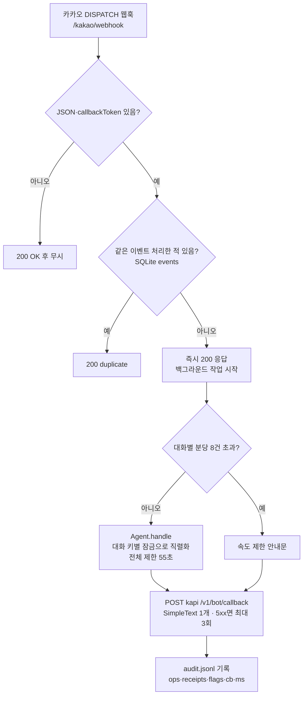

# 교동이 에이전트 판단 구조 (코드 기준, 커밋 시점 실제 동작)

핵심 한 줄: **판단은 LLM이, 금지·허용 경계는 코드가** 한다. LLM(Qwen)이 의도 파악·도구 선택·규정 해석·답변 문장을 만들고, 코드(`tools.py`·`agent.py`·`security.py`)는 인증·정보 노출·접수 허용·출력 형식을 강제한다. 정책 계산기(`policy_*`)는 **LLM이 호출할 때만** 쓰인다.

## 1. 전체 흐름 (카카오 → 답장)



## 2. 한 턴의 처리 순서 (`agent.py::_handle`)

```mermaid
flowchart TD
    A[고객 메시지] --> S[security.sanitize_input<br/>2,000자 자름 · 채팅 템플릿 토큰 제거 · 인젝션 문구 탐지]
    S --> L[세션 로드 SQLite TTL 6h]
    L --> T{메시지에 TC ID?<br/>'- id: L-03' 등}
    T -- 새 TC --> R[세션 전체 초기화<br/>이전 TC 정보 누출 방지]
    T -- 같거나 없음 --> N
    R --> N[인입 일시 → 현재 시각 설정]
    N --> I{첫 메시지 or 이전 확인이 시스템 오류?}
    I -- 예 --> IP[인입 계정 파싱<br/>'인입 계정: 회원 로그인 · 이름 · 019-****-1234']
    IP --> ID[identify: API-12(회원ID) 또는 API-13(이름)<br/>→ 전화 앞3·뒤4 대조 → 1명이면 인증 회원 확정]
    ID --> C
    I -- 아니오 --> C[컨텍스트 블록 생성<br/>TC ID · 현재 시각 · 인증 상태 · 이미 접수한 건]
    C --> M[메시지 = 시스템 프롬프트(정책 요약·유형별 처리) + 도구 규칙 + 컨텍스트<br/>+ 최근 대화 16개 + 고객 메시지(+보안 표시)]
    M --> LOOP[[LLM 도구 루프 — 3절]]
    LOOP --> PP[후처리 — 5절]
    PP --> SV[대화 기록 저장 → 답변 반환]
```

인증 상태는 4가지이고 LLM에게 문장으로 전달된다.

| 상태 | 조건 | 결과 |
|---|---|---|
| 인증됨 | 인입 계정 = 시스템 회원 1명 | 본인 주문만 안내·처리 |
| 시스템 오류 | API-12/13이 401·429·5xx | "불일치"라 말하지 않음, 다음 턴 재확인 |
| 불일치 | 인입 계정은 있으나 회원 못 찾음 | 주문 처리 전 본인 확인 필요 |
| 비로그인 | 인입 계정 표시 없음 | 주문 상세·접수 불가, 일반 안내·이관만 |

## 3. LLM 도구 루프

```mermaid
flowchart TD
    S0[step = 1] --> F{남은 시간 < 14초<br/>또는 step = 8?}
    F -- 예 --> FF[도구 없이 '최종 답변만 작성' 지시]
    F -- 아니오 --> CALL[LLM 호출 · 도구 49개 제공<br/>동시 LLM 요청 최대 4]
    FF --> CALL
    CALL --> TC{도구 호출이 있나?<br/>네이티브 · JSON · qwen3_coder XML 모두 해석}
    TC -- 예 --> EX[ToolExecutor.run 병렬 실행<br/>인자 타입을 API 스키마로 보정]
    EX --> RES[결과(JSON, 3,500자 이내)를 대화에 추가]
    RES --> S1[step + 1] --> F
    TC -- 아니오 --> ANS[이 텍스트가 답변 후보]
```

LLM에게 주는 도구 49개:
- API_01~API_40 중 39개(API-35는 `escalate`로 감쌈) — **reset은 없음**
- `escalate`(lane·target·priority·reason)
- 계산기: `policy_defect_deadline`, `policy_subscription_cutoff`, `policy_business_deadline`, `policy_price_drop`, `policy_weight_check`, `policy_promo_validity`, `calendar_info`
- 보조: `compare_order_address`, `set_test_case_id`, `register_inbound_account`

## 4. 코드 가드 — 조회(GET)

```mermaid
flowchart LR
    G[GET 요청] --> CA{세션 캐시에 같은 조회?}
    CA -- 예 --> HIT[캐시 반환 · 호출 0]
    CA -- 아니오 --> TY{대상 종류}
    TY -- 주문·배송·결제·환불<br/>API-07/10/11/17/18/30 --> OW{주문 member_id = 인증 회원?}
    OW -- 예 --> MASK[주소·수령인 이름 숨김<br/>결제자 이름 → 일치 여부만]
    OW -- 아니오 --> DEN[DENIED / UNVERIFIED<br/>존재 여부만, 상세 없음]
    TY -- 회원 정보·상담 이력·적립금·쿠폰·구독<br/>API-05/12/15/16/19 --> SELF{본인 회원 ID?}
    SELF -- 예 --> OK1[연락처·주소·생년 제외 후 반환]
    SELF -- 아니오 --> DEN
    TY -- 회원 주문 목록 API-08 --> L8{본인? / 피추천인?}
    L8 -- 본인 --> OK2[목록 반환(주소 숨김)]
    L8 -- 피추천인 --> OK3[주문번호·상태·날짜만]
    L8 -- 그 외 --> DEN
    TY -- 이름 검색 API-13 --> N13{인입 계정 이름?}
    N13 -- 예 --> OK4[회원ID + 번호 일치 여부만]
    N13 -- 아니오 --> DEN
    TY -- 로트 신고 이력 API-06 --> T6[건수·날짜·내용 일부, 다른 고객 ID 숨김]
    TY -- 상품·로트·조사·재고·프로모션·이관 조회 --> PUB[그대로 반환]
```

## 5. 코드 가드 — 접수(POST), 위에서부터 순서대로 하나라도 걸리면 호출 0

```mermaid
flowchart TD
    P[POST 요청] --> V1[① 원문 스키마 검증<br/>필수값·타입·enum·추가 필드 금지]
    V1 --> V2[② API-31/32면 결제 정보 확보(API-17)]
    V2 --> V3{③ 고객 확인 가드<br/>고객이 대화에서 직접 말한 값인가?}
    V3 -- 아니오 --> B1[blocked: '고객에게 질문 1개로 확인']
    V3 -- 예 --> V4{④ 인증 회원 있음?<br/>(재입고 알림 API-39는 예외)}
    V4 -- 아니오 --> B2[blocked: 본인 확인 필요]
    V4 -- 예 --> V5{⑤ 대상 귀속<br/>주문·배송·결제·구독·회원이 본인 것?}
    V5 -- 아니오 --> B3[blocked: DENIED]
    V5 -- 예 --> V6{⑥ 업무 규칙}
    V6 -- 위반 --> B4[blocked: 사유]
    V6 -- 통과 --> V7{⑦ 같은 접수·같은 대상 이미 있음?}
    V7 -- 예 --> DUP[기존 접수번호 반환 · 재호출 안 함]
    V7 -- 아니오 --> SUB[Action API 호출 → 실제 접수번호]
    SUB --> INV[주문 캐시 무효화(환불·변경 후)]
```

③ 고객 확인 가드(`_confirm_guard`, `DISABLE_CONFIRM_GUARD=1`로 끔):

| 접수 | 고객 발화에 있어야 하는 것 |
|---|---|
| 환불·변경·배송지·일정·메모·긴급출고·픽업 (API-29/23/24/25/26/27/38) | 대상 주문번호 |
| 카드 취소·현금영수증 (API-31/32) | 그 결제의 주문번호(또는 승인번호) |
| 현금영수증 (API-32) | 발행 번호 + 발행 구분(소득공제·지출증빙·연말정산·개인용·사업자용 등) |
| 배송지 변경 (API-24) | 새 주소(그대로, 또는 동·호수 숫자 2개 이상 일치) |
| 주문 복구 (API-22) | 제외 |

⑥ 업무 규칙:

| 접수 | 규칙 |
|---|---|
| 환불 API-29 | 0 < 금액 ≤ 주문 실결제액. 5만원 초과는 주문 전액·품목 전액일 때만(하자 전액환불·규정상 반환), 아니면 OPS 이관 지시 |
| 카드 취소 API-31 | 결제 상태 APPROVED + 카드 결제만 |
| 현금영수증 API-32 | 결제 상태 APPROVED + 카드 결제 아님 |
| 쿠폰 발급 API-33 | 본인 회원 + 원장에 있는 코드(CARE3000/5000/10000은 조회 생략, 그 외 API-20 확인) |
| 리워드 API-34 | 본인 회원 |
| 긴급출고·픽업 API-27/38 | 수량 ≥ 1 |
| 재배송비 API-37 | 금액 > 0 |
| 구독 변경 API-40 | 본인 구독 + 해지 상태 아님 |
| 이관 escalate | lane ∈ {LANE1_BOT, LANE2_HANDOFF, LANE3_CLAIM}, LANE2면 target ∈ {SECURITY, SAFETY_LEGAL, LOGISTICS, SUPPLY, OPS}, reason 앞에 `[대상][우선순위]`, 같은 lane·대상 중복 차단 |

## 6. 답변 후처리

```mermaid
flowchart TD
    A[답변 후보] --> L1{500자 초과 + 시간 10초 이상 남음?}
    L1 -- 예 --> CMP[LLM에 430자 요약 요청]
    L1 -- 아니오 --> E
    CMP --> E{답변이 비었나?<br/>(LLM 오류·시간 초과)}
    E -- 예, 접수 있음 --> FB1[접수번호를 담은 기본 문장]
    E -- 예, 접수 없음 --> FB2[일시 문제 안내 + 대표전화]
    E -- 아니오 --> LK
    FB1 --> LK
    FB2 --> LK{누출 검사<br/>API_xx·policy_·토큰·TC 헤더명·내부 섹션명<br/>(인젝션 턴엔 프롬프트 원문 40자 일치도)}
    LK -- 누출 --> SAFE[내부 지침 비공개 안내문으로 교체]
    LK -- 정상 --> CL
    SAFE --> CL[마크다운 제거 · 문장 경계에서 500자 자름]
    CL --> OUT[SimpleText 1개]
```

## 7. 누가 무엇을 결정하나

| 결정 | 주체 | 근거 위치 |
|---|---|---|
| TC ID·인입 계정·현재 시각 인식 | 코드(정규식) | `parser.py` |
| 인증 회원 확정 | 코드(API-12/13 + 번호 대조) | `tools.identify` |
| 문의 의도·필요한 조회 선택·조회 순서 | **LLM** | 프롬프트 '유형별 처리' |
| 규정 해석(하자·환불·쿠폰·구독·증빙·이관 여부) | **LLM** | `knowledge.py` 정책 요약 |
| 날짜·기한·차액·중량 계산 | 코드, 단 **LLM이 계산기를 호출했을 때만** | `policy.py`, `calendar2037.py` |
| 레인·이관 대상·우선순위 선택 | **LLM**(형식은 코드 검증) | `escalate` |
| 무엇을 보여 줄지(개인정보·타인 주문) | 코드 | `_get` 가드 |
| 접수 허용 여부 | 코드(①~⑦) + LLM(그 접수를 할지) | `_post` 가드 |
| 환불 금액 | **LLM**(코드는 상한·5만원 규칙만) | — |
| 답변 문장 | **LLM** | — |
| 답변 길이·형식·내부 정보 누출 차단 | 코드 | `text_out.py`, `security.py` |

## 8. 알려진 약점 (코드로 강제되지 않는 부분)

1. 계산기를 부르지 않고 LLM이 날짜·금액을 직접 계산할 수 있다(프롬프트로만 유도).
2. 레인·이관 대상 선택, 이관 여부 자체는 LLM 판단(L-11·L-23·L-34처럼 '별도 이관'이 필요한 경우 누락 가능).
3. 조회 최소화는 프롬프트로만 유도(L-05에서 카드 주문까지 조회한 전례). 접수는 ③가드가 막지만 불필요한 GET은 막지 못한다.
4. 인증·귀속 확인을 위해 모범 처리에 없는 API-13·API-07 조회가 추가로 발생한다.
5. 이미지·음성 첨부는 내용을 볼 수 없다(URL만 인지).
6. 답변 문장의 사실성(근거 없는 약속 등)은 LLM 품질에 달려 있다.
